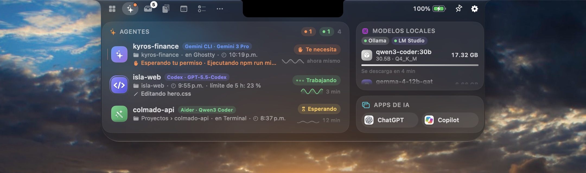
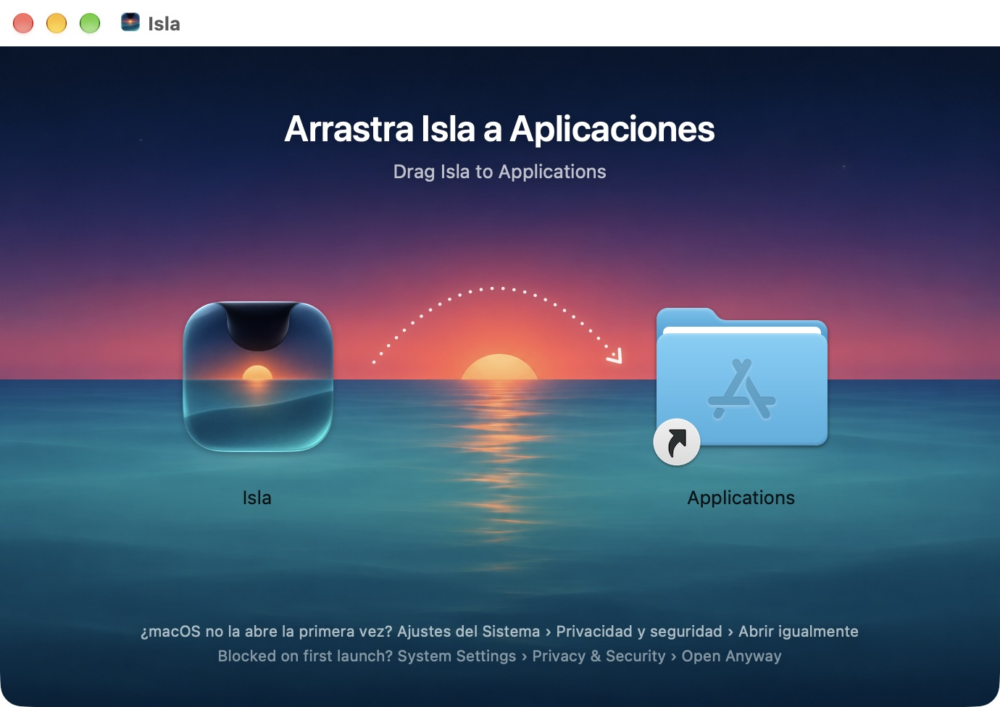
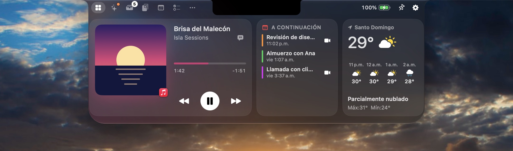

# Novedades

Versión en español de [CHANGELOG.md](CHANGELOG.md). Cada sección `## x.y.z` se publica en https://isla.kyrosrd.com/novedades/.

## 1.1.17 — 2026-11-08

- **Temporizador compacto.** Un temporizador o un Pomodoro en marcha también se queda con orejas pequeñas: su anillo junto a la cámara y la cuenta atrás al otro lado. Su nombre (Enfoque, Descanso corto o tu etiqueta) aparece unos segundos al empezar o al cambiar de fase, y mientras el puntero descansa sobre la isla.

## 1.1.16 — 2026-11-08

- **Controles de música en la isla.** Mientras suena música, apoya el puntero en la isla y sale un pequeño reproductor bajo la cámara: la canción, el artista y los botones de anterior, reproducir o pausar y siguiente, sin abrir el Nook. Quédate un momento más sobre la cámara para abrir el Nook como siempre; mientras el puntero está en los botones del reproductor, no se abre encima de ellos. Puedes apagarlo en Ajustes › Música.

## 1.1.15 — 2026-11-08

- **La isla se aparta de la barra de menús.** Lleva el puntero por la barra de menús junto a la isla, camino de un menú o del ícono de otra app, y las orejas de la actividad en curso se recogen en la cámara (también la burbuja), así ves y pulsas lo que tapaban. Vuelven en cuanto el puntero sale de la barra. Apoyar el puntero en la cámara sigue sacando la isla, y si solo la cruzas por la barra ya no se despierta.
- **Actividades compactas.** Los agentes de IA trabajando, las descargas y las próximas reuniones se quedan ahora con orejas pequeñas junto a la cámara: el ícono del agente y sus puntos, el anillo de la descarga y su porcentaje, la cámara de la reunión y la cuenta atrás. El detalle (el proyecto, el archivo, la reunión) se despliega unos segundos cuando algo cambia y siempre que apoyas el puntero en la isla. Antes, un agente trabajando podía tapar más de 450 puntos de la barra de menús.
- Las dos opciones están en Ajustes › Actividades en vivo › Junto a la barra de menús.

## 1.1.14 — 2026-11-07

- **Buscar** (⌃⌥K, o la lupa del Nook): abre apps y los archivos que has abierto, salta a cualquier pestaña, usa las acciones de Isla, encuentra lo que copiaste, calcula («128 * 4,5 + 2^10»), convierte unidades («10 km a mi») y divisas («100 usd a dop»), inicia un temporizador («temporizador 25») o escribe una nota («nota llamar a Ana»). El resultado sale grande arriba y Return lo copia. Lo que eliges sube en la lista la próxima vez.
- **Chat con tus modelos locales**: la nueva pestaña Chat habla con Ollama o LM Studio justo bajo la cámara, con respuestas que llegan palabra a palabra. Resume, traduce o explica lo que copiaste con un clic. Solo habla con el servidor de tu Mac y nunca lo arranca. También desde Buscar: escribe una pregunta y elige «Preguntar».
- **Monitor del sistema**: un widget Sistema para el Nook con gráficas de CPU y red, memoria, disco libre y estado térmico, y orejas opcionales de CPU y red alrededor del notch cerrado (Ajustes › Actividades en vivo). Las gráficas las dibuja Core Animation, así que casi no gastan.
- **Llamadas en la isla**: una llamada entrante de FaceTime, o de tu iPhone, suena en la isla con botones grandes de Aceptar y Rechazar, que responden al aviso de llamada del sistema. Se va cuando contestas en otro sitio o la pierdes. Puedes apagarlo en Ajustes › Notificaciones.
- Los tipos de cambio de las conversiones de divisas vienen de ExchangeRate-API, solo cuando conviertes una divisa y como mucho dos veces al día. Nada más nuevo sale de tu Mac.

## 1.1.13 — 2026-11-06

- **Notificaciones en el notch.** Mensajes, WhatsApp, Mail y cualquier otra app (también las que llegan del iPhone) aparecen ahora en la isla: el ícono real de la app y el remitente junto a la cámara, y el mensaje debajo. Isla lee los avisos que dibuja macOS mediante Accesibilidad, el mismo permiso que ya usa para el indicador de volumen, así que no necesita Acceso total al disco y nada sale de tu Mac.
- La notificación sale de la cámara igual que el Nook: la isla primero se ensancha y luego baja con un pequeño rebote, el ícono aterriza con una onda y un brillo suave del color de la app. Los mensajes de personas hacen que la isla dé su pequeña sacudida.
- Cuando llegan varias se apilan y las anteriores asoman por debajo; los mensajes de una misma conversación se juntan en una sola tarjeta con un contador.
- Haz clic en una notificación para ir directo a su conversación (o a la app). Deja el puntero encima para que se quede y se despliegue un mensaje largo; deslízala hacia la cámara o a un lado para descartarla, con el trackpad o arrastrando.
- Si llega una con el Nook abierto, cae como una pequeña tarjeta bajo la cámara en vez de esperar.
- Nuevo panel Ajustes › Notificaciones: activarlas o desactivarlas, elegir qué apps se muestran, ocultar el contenido hasta que dejes el puntero sobre la isla, elegir un sonido y, si quieres, cerrar el aviso del sistema cuando el notch ya lo muestra. La Concentración y No molestar se respetan siempre: lo que macOS silencia también se queda en silencio en el notch.
- Nuevo widget del Nook, Notificaciones, con las más recientes. Solo se guardan en memoria y desaparecen al cerrar Isla.

## 1.1.12 — 2026-11-06

- Cuando algo te necesita (un agente esperando tu respuesta, un temporizador que terminó, la batería baja), la isla da una pequeña sacudida después de crecer, como la Dynamic Island.
- Al apoyar el puntero en el notch aparece un pequeño tirador al pie de la isla: se puede abrir tirando de ella.
- Al apoyar el puntero en el ícono de una pestaña del Nook, su nombre aparece justo debajo, más rápido que la ayuda del sistema.
- Las listas del notch se deslizan con suavidad: las filas de la pestaña IA, Calendario, Tareas, Notas y Atajos, y los elementos de la Bandeja y del Portapapeles, entran y salen por los bordes al desplazarte en vez de cortarse.
- La cifra de la batería y el contador de la Bandeja ruedan hasta su nuevo valor.
- Ajustes › Apariencia muestra el panel abierto en sus proporciones reales sobre la pantalla de un Mac, y salta con un resorte al tamaño que eliges.
- La web es más limpia y fluida: superficies planas sin bordes ni brillos sobrantes, texto más grande, la isla de la demo se ensancha primero y luego baja como en la app, las pestañas se funden, el paisaje se mueve al desplazarte y cambiar de idioma o ir a Novedades se funde en vez de saltar.

## 1.1.11 — 2026-11-05

- La isla se abre como un líquido que sale de la cámara: primero se ensancha y luego baja con un pequeño rebote, y al cerrarse se pliega hacia arriba antes de recogerse en la cámara. El ancho y el alto se mueven ahora con su propio resorte, y el contenido se recoge con el panel en vez de solo desvanecerse.
- Los íconos de las pestañas salen de la cámara uno tras otro al abrir el Nook, y la pestaña que eliges da un pequeño salto.
- El panel abierto tiene un hilo de luz en los lados y abajo, y las tarjetas reciben luz desde arriba y brillan un poco bajo el puntero, para que todo se lea bien sobre cualquier fondo, en Liquid Glass y en negro.
- Las orejas de una actividad en vivo se van enseguida al abrir el Nook, así nunca se quedan encima.
- Con «Reducir movimiento» activado, la isla se abre y se cierra con un cambio de tamaño simple y corto.

## 1.1.10 — 2026-11-05

- VoiceOver nombra cada botón con ícono del notch por lo que hace: letras, unirse a una reunión, abrir Calendario, menos o más minutos, restablecer, reproducir el sonido de enfoque, nueva nota, eliminar, reiniciar, más o menos velocidad, texto más grande o más pequeño. Antes algunos se leían por su símbolo («burbuja», «círculo», «basurero»).
- Las casillas de las tareas se leen como la tarea y si está completada.

## 1.1.9 — 2026-11-05

- Corrige que salir de la pestaña Teleprompter tocara el micrófono: si nunca se había respondido al permiso del micrófono, macOS lo pedía e Isla se quedaba congelada hasta contestar, aunque no usaras «Seguir voz». Ahora el micrófono solo se usa mientras «Seguir voz» está activo.
- La web muestra la pestaña IA, con capturas nuevas de todas las pestañas.

## 1.1.8 — 2026-11-05

- Dos cosas a la vez, como la Dynamic Island: cuando hay una segunda actividad en marcha (un agente trabajando mientras suena música, un temporizador y una descarga…), se separa en una burbuja pequeña junto a la isla con la portada de la canción, el ícono del agente o un anillo de progreso. Haz clic en la burbuja para abrir su pestaña. Puedes apagarlo en Ajustes › Actividades en vivo.

## 1.1.7 — 2026-11-05

- Un agente que termina y se cierra (una ejecución puntual, una terminal cerrada) ya no desaparece sin más: se queda diez minutos en la pestaña IA como **Terminado**, y la isla avisa de que acabó.
- Las apps de IA abiertas aparecen como fichas con su nombre, y cuando LM Studio u Ollama están en marcha sin ningún modelo cargado, un botón los abre.
- Una pestaña con mucho contenido ya no puede empujar la cabecera del notch hacia arriba, bajo la cámara.

## 1.1.6 — 2026-11-05

- El menú de la barra de menús muestra los agentes trabajando o esperando, con su estado; haz clic en uno para traer su app al frente. También abre la pestaña IA.
- ⌘0 cambia a la décima pestaña, después de ⌘1…⌘9.
- VoiceOver lee la cabecera del notch por su nombre (Nook, IA, Bandeja… Mantener abierto, Ajustes) en lugar de describir los íconos, y lee cada agente con su herramienta, modelo, estado, paso actual y carpeta.

## 1.1.5 — 2026-11-05

- La ventana de Ajustes se llama como el panel en el que estás, como los Ajustes del Sistema.
- En la pestaña IA, un título de sesión largo conserva su espacio: la etiqueta se acorta al modelo, porque el ícono ya muestra la herramienta.
- Los estados vacíos de todas las pestañas salen del notch línea por línea, como las tarjetas del Nook.
- El recorrido de bienvenida presenta los Agentes de IA.

## 1.1.4 — 2026-11-05

- Más ahorro de batería, medido pestaña por pestaña: la pestaña Enfoque con un temporizador en marcha pasó de un 39 % de un núcleo a menos de un 2 %, y un temporizador alrededor del notch cerrado de un 10 % a menos de un 1,5 %.
- El cronómetro solo se redibuja mientras corre, y los anillos de los temporizadores ya no animan cada segundo un cambio demasiado pequeño para verse.
- Las descargas de tamaño desconocido giran su anillo con Core Animation en lugar de redibujar el notch.

## 1.1.3 — 2026-11-05

- Mucho más ligera con la batería: las animaciones del notch (los puntos de los agentes, el halo y el ecualizador de la música) ahora usan Core Animation. Con un agente trabajando o música sonando y el notch cerrado, Isla pasó de un 12 % de un núcleo a un 0,2 %, y la pestaña IA abierta de un 45 % a menos de un 2 %.
- Un agente que espera tu permiso, una respuesta o un diálogo ahora aparece como **Te necesita**, con el motivo y lo que pidió, y la isla te avisa al instante. También cuenta cuando Codex pide aprobación.
- La pestaña IA muestra el tamaño del contexto de cada sesión al pasar el puntero sobre su modelo.
- Sonido opcional cuando un agente termina o te necesita, en Ajustes › Agentes de IA.

## 1.1.2 — 2026-11-05

- Nuevo widget **Agentes de IA** para el Nook: los agentes trabajando, su proyecto, su estado y el tiempo, de un vistazo junto a tu música y el clima. Haz clic para abrir la pestaña IA. Añádelo en Ajustes › Nook y widgets.
- La barra de progreso de Tareas ahora va a juego con el resto del notch y se queda vacía hasta que terminas algo.

## 1.1.1 — 2026-11-05

- La pestaña IA muestra el modelo que usa cada sesión, cuándo empezó y cuánto tiempo lleva trabajando o esperando.
- Las sesiones de Codex ahora muestran si hay un turno en marcha, qué está haciendo (el comando que ejecuta o el archivo que edita) y cuánto lleva usado de su límite de uso de 5 horas.
- Los modelos locales muestran los servidores en marcha debajo del título, y el tamaño de contexto pasó a la ayuda emergente, así que nada se corta.
- Los nombres de carpeta se leen bien: cuando falta espacio, la pestaña IA muestra solo el proyecto.
- Las listas del notch (IA, Calendario, Tareas, Enfoque y Notas) se desvanecen en los bordes en lugar de cortarse.

## 1.1.0 — 2026-11-05

- Nueva pestaña **IA**: los agentes de programación que corren en tu Mac, en Terminal o en su propia app, con la carpeta en la que trabaja cada uno, desde cuándo está en marcha y si está trabajando, esperando o te necesita. También muestra qué hace cada agente en este momento y su actividad del último minuto.
- Los editores con agente, como Antigravity y Cursor, aparecen con su proyecto abierto, y las apps de IA que tienes abiertas quedan a un clic.
- Modelos locales: mira qué modelos tienen Ollama y LM Studio en memoria, cuánta memoria usan y cuándo se descargan.
- Mientras un agente trabaja, su ícono y su proyecto aparecen alrededor del notch cerrado. Cuando termina o se para a preguntarte algo, la isla te avisa, y un punto en la pestaña IA también lo indica.
- Ajustes › Agentes de IA activa o desactiva la pestaña, la actividad en el notch y los avisos, y te deja añadir cualquier otro agente por el nombre de su comando. Sin permisos nuevos: Isla solo mira tus propios procesos y nada sale de tu Mac.

## 1.0.5 — 2026-11-05

- La sección Actualizaciones de Ajustes › Acerca de ya está traducida por completo.
- Ajustes › Privacidad explica qué hacer cuando Accesibilidad aparece activada en Ajustes del Sistema pero no se aplica a Isla.
- Comprobado en un Mac real: los permisos que concedes a Isla se conservan al actualizar.

## 1.0.4 — 2026-11-05

- El Nook ahora se abre como la Dynamic Island: con un rebote suave, y las tarjetas salen del notch una tras otra.
- Las pestañas entran desde el lado que elegiste, y sus íconos se iluminan bajo el puntero.
- Las actividades en vivo salen de la cámara hacia cada lado.
- Una canción nueva cambia la portada con un desenfoque suave, y el notch se infla cuando le arrastras un archivo.
- Los permisos que concedas a la 1.0.3 o posterior se conservan en cada actualización.

## 1.0.3 — 2026-11-05

- Isla ya conserva el permiso de Accesibilidad y los demás al actualizarse. Cada versión se firma con una identidad estable en lugar de una distinta cada vez. Como la identidad cambia una sola vez, macOS vuelve a pedir los permisos de Isla después de instalar la 1.0.3: permite de nuevo Calendario, Recordatorios, Ubicación y los demás desde el Nook o Ajustes › Privacidad, y apaga y enciende Accesibilidad para Isla en Ajustes del Sistema.
- El recorrido de bienvenida y Ajustes › Privacidad muestran cada permiso en cuanto lo concedes, sin volver a abrirlos.
- La tarjeta del clima muestra las próximas horas debajo de la temperatura actual.

## 1.0.2 — 2026-11-05

- Corrige que Isla no abriera: las versiones 1.0.0 y 1.0.1 se cerraban justo al iniciar en todos los Mac. Si instalaste una de ellas, descarga Isla de nuevo desde isla.kyrosrd.com.
- La ventana de bienvenida, los Ajustes, AirDrop y Vista rápida ahora aparecen al frente y responden al teclado.
- Cerrar la bienvenida antes de tiempo ya no deja apagados el calendario, el clima, el Bluetooth ni la búsqueda de actualizaciones hasta el siguiente inicio.
- Ahora cada versión se abre y se comprueba antes de publicarse.

## 1.0.1 — 2026-11-05

- Un instalador ilustrado nuevo: arrastra Isla sobre el atardecer caribeño para instalarla, con ayuda para la primera apertura en español e inglés.
- La app ya muestra su ícono nuevo. La versión 1.0.0 salió con el anterior.
- Pasos más claros para abrirla por primera vez en macOS 26: Ajustes del Sistema › Privacidad y seguridad › Abrir igualmente.

## 1.0.0 — 2026-11-05

Primera versión pública.

- Panel del notch en cada pantalla, en Liquid Glass o negro clásico, con tres tamaños y una isla en las pantallas sin notch.
- Nook con widgets a tu gusto: Reproduciendo, A continuación, Clima, Enfoque, Batería y dispositivos, Atajos, Bandeja y Nota rápida.
- Reproduciendo para cualquier app de la sesión «Reproduciendo» del sistema, con letras sincronizadas y respaldo por AppleScript para Música y Spotify.
- Bandeja con arrastrar y soltar, AirDrop, compartir y conversiones en tu Mac, más el Bolsillo que aparece al agitar el puntero.
- Historial del portapapeles con búsqueda, filtros, fijados y pegado automático.
- Calendario con enlaces de reunión, Tareas sincronizadas con Recordatorios, Notas, Espejo, Teleprompter que sigue tu voz y Atajos.
- Pomodoro, temporizadores, cronómetro y sonidos de enfoque generados en tu Mac.
- Actividades en vivo para música, carga, dispositivos Bluetooth, volumen y brillo, descargas, reuniones, temporizadores y Bloq Mayús.
- Reemplazo opcional del indicador de volumen y brillo del sistema.
- Pestaña de Terminal con SwiftTerm, Acciones rápidas (mantener despierto, cuentagotas, captura a la Bandeja, bloquear la pantalla, modo oscuro), Vista rápida en la Bandeja y letras sincronizadas bajo la isla.
- Actualizaciones automáticas con Sparkle, firmadas con EdDSA y servidas desde isla.kyrosrd.com.
- Ícono nuevo de la app.
- Español e inglés.
