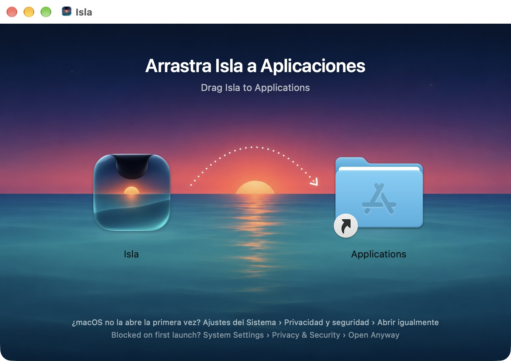
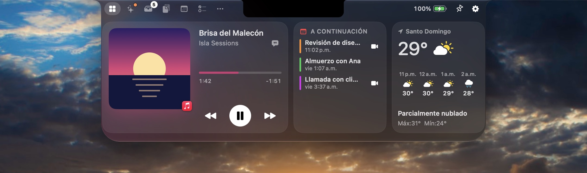

# Changelog

## 1.0.1 — 2026-11-05

- A new illustrated installer: drag Isla onto the Caribbean dusk to install, with first-launch help in English and Spanish.
- The app now shows its new icon. Version 1.0.0 shipped with the previous one.
- Clearer first-launch steps for macOS 26: System Settings › Privacy & Security › Open Anyway.

## 1.0.0 — 2026-11-05

First public release.

- Notch panel for every display, with Liquid Glass or Classic Black, three sizes and an island on displays without a notch.
- Nook with configurable widgets: Now Playing, Up Next, Weather, Focus, Battery & Devices, Shortcuts, Shelf and Quick Note.
- Now Playing for any app in the system Now Playing session, with synced lyrics and AppleScript fallback for Music and Spotify.
- Shelf with drag and drop, AirDrop, sharing and on-device conversions, plus the shake-to-open Pocket.
- Clipboard history with search, filters, pins and auto-paste.
- Calendar with meeting links, Tasks synced with Reminders, Notes, Mirror, Teleprompter with voice follow and Shortcuts.
- Pomodoro, countdown timers, stopwatch and generated focus sounds.
- Live activities for music, charging, Bluetooth devices, volume and brightness, downloads, meetings, timers and Caps Lock.
- Optional replacement for the system volume and brightness overlay.
- Terminal tab powered by SwiftTerm, Quick Actions (keep awake, color picker, capture to Shelf, lock screen, dark mode), Quick Look on the Shelf and synced lyrics under the island.
- Automatic updates through Sparkle, signed with EdDSA and served from isla.kyrosrd.com.
- New app icon.
- English and Spanish.
