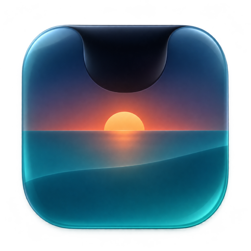
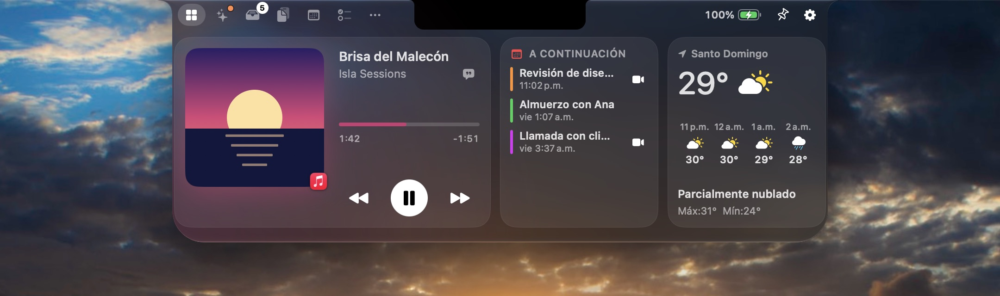
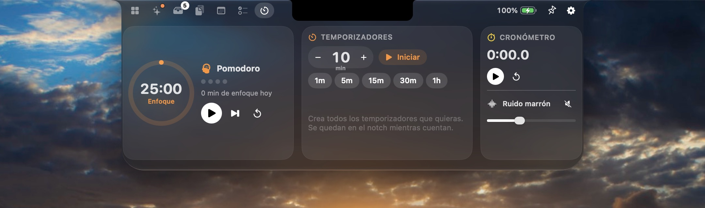
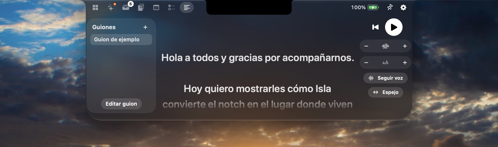

<p align="center">
  
</p>

<h1 align="center">Isla</h1>

<p align="center">
  <strong>Tu notch, ahora es isla.</strong><br>
  Una app nativa, gratis y de código abierto para macOS que convierte el notch de tu MacBook en una isla viva:<br>
  música con letras sincronizadas, una Bandeja de archivos con AirDrop, calendario, portapapeles, temporizadores y actividades en vivo.
</p>

<p align="center">
  <a href="https://isla.kyrosrd.com/downloads/Isla.dmg"><b>Descargar</b></a> ·
  <a href="README.md">Read in English</a> ·
  <a href="CONTRIBUTING.md">Contribuir</a>
</p>

<p align="center">
  
</p>

---

## Lo esencial

- **Hecha como lo haría Apple.** Swift y SwiftUI, el **Liquid Glass** del sistema, SF Symbols, respuesta háptica y unos Ajustes que se sienten como Ajustes del Sistema. Elige Liquid Glass o Negro clásico.
- **Funciona en todas partes.** En MacBooks con notch, en Macs sin él y en monitores externos, donde Isla dibuja una isla equivalente.
- **Privada por diseño.** Sin cuentas, sin analíticas, sin rastreo. Tus notas, la Bandeja y el portapapeles se quedan en tu Mac.
- **Gratis para siempre.** Licencia MIT. Léela, haz un fork, mejórala.

## Funciones

| | |
| --- | --- |
| **Nook** | Una fila de widgets que eliges y ordenas: Reproduciendo, A continuación, Clima, Enfoque, Batería y dispositivos, Atajos, Bandeja y Nota rápida. |
| **Música** | Sigue cualquier app de «Reproduciendo» del Centro de control (Música, Spotify, Podcasts, navegadores). Portada, barra para adelantar, controles, **letras sincronizadas** de LRCLIB (también bajo la isla), vidrio teñido con la portada y ecualizador animado. Desliza de lado sobre el notch para cambiar de canción. |
| **Bandeja** | Suelta archivos en el notch y arrástralos fuera donde quieras. **AirDrop**, Compartir y conversión a PNG, JPEG, HEIC, TIFF, PDF, PDF combinado, MP4, M4A o ZIP. El texto y las imágenes que sueltas se vuelven archivos. |
| **Bolsillo** | Agita el puntero mientras arrastras archivos y aparece un Bolsillo de vidrio justo ahí para recibirlos. |
| **Portapapeles** | Historial con búsqueda, filtros (texto, enlaces, imágenes, archivos, colores), elementos fijados y pegado con un clic. Nunca guarda lo marcado como oculto ni lo que viene de gestores de contraseñas. |
| **Calendario** | Franja de dos semanas y agenda del día con todos los calendarios de tu Mac, botón **Unirse** para Zoom, Meet, Teams, Webex y más, y creación rápida de eventos. |
| **Tareas** | Sincronizadas con Recordatorios, o locales si lo prefieres. |
| **Enfoque** | Pomodoro con descansos largos, todos los temporizadores que quieras, cronómetro y sonidos de enfoque (ruido marrón, rosa, blanco y lluvia suave) generados en el equipo. |
| **Notas** | Notas rápidas que viven en tu Mac, con exportación a Notas. |
| **Espejo** | Revisa tu cámara antes de una llamada. |
| **Teleprompter** | Lee guiones justo bajo el lente. Avanza a tu ritmo o **sigue tu voz** con reconocimiento en el equipo. Modo espejo para teleprompters de cristal. |
| **Atajos** | Ejecuta tus atajos de macOS desde el notch, con favoritos. |
| **Terminal** | Una terminal real bajo el notch (SwiftTerm) que sigue funcionando aunque cambies de pestaña o cierres el panel. |
| **Acciones rápidas** | Mantén el Mac despierto, toma un color de cualquier parte, captura a la Bandeja, bloquea la pantalla o cambia a modo oscuro. |
| **Actualizaciones** | Actualizador integrado (Sparkle) con versiones firmadas. Revisa una vez al día y te avisa en la isla cuando hay versión nueva. |
| **Actividades en vivo** | Música, cambio de canción, carga y batería baja, **AirPods y dispositivos Bluetooth con batería**, volumen y brillo, descargas con progreso, próximas reuniones, temporizadores y Bloq Mayús. |
| **HUD del sistema** | Puede reemplazar el indicador de volumen y brillo por un control fino bajo el notch (⌥⇧ para pasos finos). |
| **Gestos y teclas** | Pasa el puntero o desliza hacia abajo para abrir, hacia arriba para cerrar, ⌃⌥Espacio para abrir o cerrar, ⌃⌥V para el portapapeles, ⌘1…⌘9 para cambiar de pestaña. Todo es configurable. |
| **Idiomas** | Español e inglés. |

<p align="center">
  
  
</p>

## Requisitos

- macOS 26 Tahoe o posterior (Isla usa el Liquid Glass del sistema).
- Mac con Apple silicon o Intel. El notch es opcional.

## Instalación

1. Descarga **Isla.dmg** desde la [última versión](https://isla.kyrosrd.com/downloads/Isla.dmg).
2. Ábrelo y arrastra **Isla** a **Aplicaciones**.
3. Las versiones de la comunidad se firman sin certificado de pago. La primera vez, haz clic derecho en Isla, elige **Abrir** y confirma.
4. El recorrido de bienvenida te deja activar solo los permisos que quieras.

## Compilar desde el código

```bash
git clone https://github.com/Kyros-Solutions-RD/isla.git
cd isla
brew install xcodegen
xcodegen generate
open Isla.xcodeproj
```

Pulsa ⌘R en Xcode 26 o posterior. Para generar un DMG:

```bash
./scripts/build-dmg.sh
```

## Privacidad

Isla pide solo lo que una función necesita, cuando la activas: Calendario, Recordatorios, Cámara (Espejo), Ubicación (clima), Micrófono y voz (teleprompter), Bluetooth (actividades de dispositivos) y Accesibilidad (HUD del sistema y pegado automático). Funciona sin ninguno de ellos. El clima usa [Open-Meteo](https://open-meteo.com) con una ubicación aproximada, las letras vienen de [LRCLIB](https://lrclib.net) y la búsqueda de actualizaciones descarga la lista de versiones de [isla.kyrosrd.com](https://isla.kyrosrd.com) (se puede apagar en Ajustes). Nada más sale de tu Mac.

## Contribuir

Los reportes y pull requests son bienvenidos. Lee [CONTRIBUTING.md](CONTRIBUTING.md) para empezar.

## Licencia

[MIT](LICENSE) © 2026 Kyros Solutions RD. Hecha en Santo Domingo, República Dominicana.

Mac, macOS, AirPods y AirDrop son marcas de Apple Inc. Isla es un proyecto independiente y no está afiliado a Apple.
