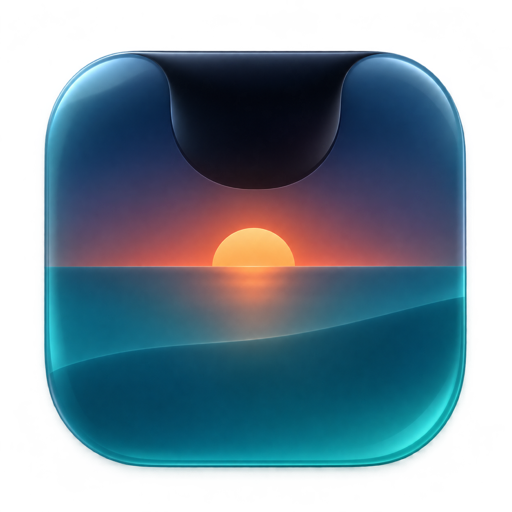
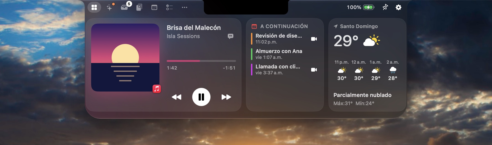
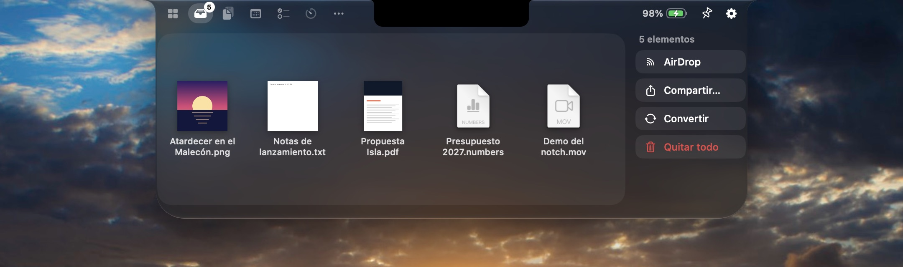
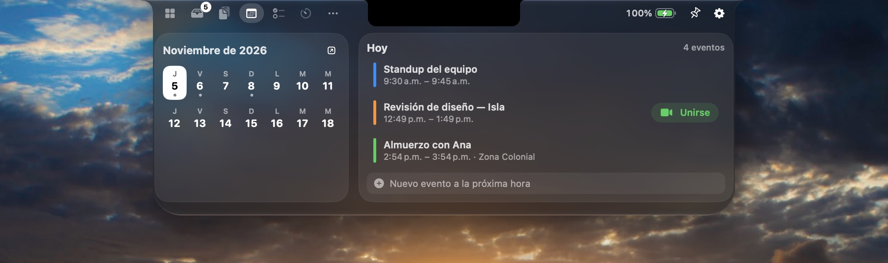
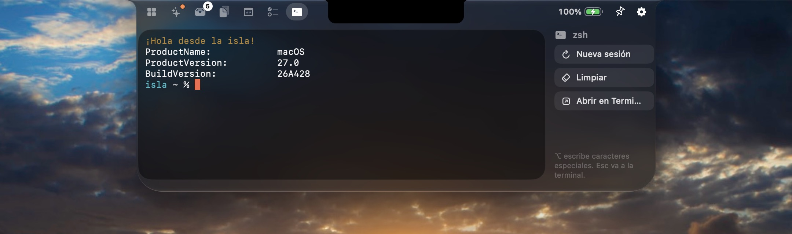
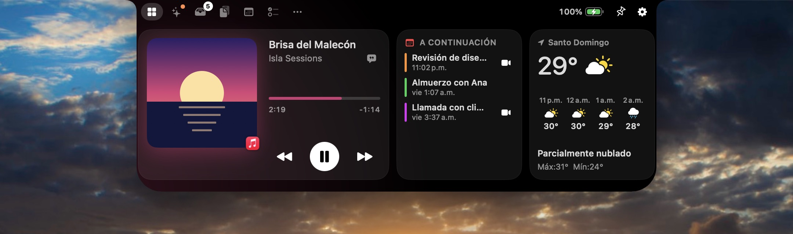

<p align="center">
  
</p>

<h1 align="center">Isla</h1>

<p align="center">
  <strong>Your notch, now an island.</strong><br>
  A native, free and open-source macOS app that turns the MacBook notch into a living island:<br>
  music with synced lyrics, a file Shelf with AirDrop, calendar, clipboard, focus timers and live activities.
</p>

<p align="center">
  <a href="https://isla.kyrosrd.com/downloads/Isla.dmg"><b>Download</b></a> ·
  <a href="README.es.md">Leer en español</a> ·
  <a href="CONTRIBUTING.md">Contribute</a>
</p>

<p align="center">
  
</p>

---

## Highlights

- **Built like Apple would.** Swift and SwiftUI, the system's **Liquid Glass**, SF Symbols, haptics and a Settings window that feels like System Settings. Choose Liquid Glass or Classic Black.
- **Works everywhere.** On MacBooks with a notch, on Macs without one and on external displays, where Isla draws a matching island.
- **Private by design.** No accounts, no analytics, no tracking. Your notes, Shelf and clipboard history stay on your Mac.
- **Free forever.** MIT licensed. Read it, fork it, improve it.

## Features

| | |
| --- | --- |
| **Nook** | A row of widgets you pick and order: Now Playing, Up Next, Weather, Focus, Battery & Devices, Shortcuts, Shelf, Quick Note, Quick Actions, AI Agents and Notifications. |
| **Notifications** | Messages, WhatsApp, Mail and every other app: their notifications come out of the camera with the app's real icon, the sender and the message. They stack when several arrive and group by conversation; click to open the conversation, rest the pointer to read it all, swipe to dismiss. Optional hidden content, sound and closing the system banner. Follows your Focus. Read through Accessibility, kept only in memory. |
| **AI** | The coding agents running on your Mac, in Terminal or in their own app: the folder each one works in, since when, whether it is working, waiting or needs you, and what it is doing right now. Plus the models Ollama and LM Studio keep in memory and the AI apps you have open. No permissions needed. |
| **Now Playing** | Follows any app in Control Center's Now Playing (Music, Spotify, Podcasts, browsers). Artwork, scrubber, controls, **synced lyrics** from LRCLIB (optionally shown right under the island), artwork-tinted glass and an animated equalizer. Swipe sideways on the notch to change tracks. |
| **Shelf** | Drop files on the notch and drag them back out anywhere. **AirDrop**, Share, Quick Look (Space), convert to PNG, JPEG, HEIC, TIFF, PDF, merged PDF, MP4, M4A or ZIP. Text and images you drop become files. |
| **Pocket** | Shake the pointer while dragging files and a glass Pocket appears right there to catch them. |
| **Clipboard** | Searchable history with filters (text, links, images, files, colors), pinned items and one-click paste. Concealed items and password managers are never recorded. |
| **Calendar** | Two-week strip and day agenda from every calendar on your Mac, one-click **Join** for Zoom, Meet, Teams, Webex and more, and quick event creation. |
| **Tasks** | Synced with Apple Reminders, or kept locally if you prefer. |
| **Focus** | Pomodoro with long breaks, any number of countdown timers, a stopwatch and focus sounds (brown, pink, white noise and soft rain) generated on device. |
| **Notes** | Quick notes that live on your Mac, with export to Apple Notes. |
| **Mirror** | Check your camera before a call. |
| **Teleprompter** | Read scripts right under the lens. Scrolls at your pace or **follows your voice** with on-device speech recognition. Mirror mode for beam-splitter rigs. |
| **Shortcuts** | Run your macOS Shortcuts from the notch, with favorites. |
| **Terminal** | A real shell under the notch (SwiftTerm) that keeps running while you switch tabs or close the panel. |
| **Quick Actions** | Keep your Mac awake, pick a color from anywhere, capture a screenshot to the Shelf, lock the screen or toggle dark mode. |
| **Live activities** | Music, track changes, charging and low battery, **AirPods and Bluetooth devices with battery**, volume and brightness, downloads with progress, upcoming meetings, timers, **AI agents at work**, **notifications** and Caps Lock. |
| **System HUD** | Optionally replaces the volume and brightness overlay with a slim slider under the notch (⌥⇧ for fine steps). |
| **Gestures & keys** | Hover or swipe down to open, swipe up to close, ⌃⌥Space to toggle, ⌃⌥V for the clipboard, ⌘1…⌘9 to switch tabs. All shortcuts are configurable. |
| **Updates** | Built-in updater (Sparkle) with signed releases. Checks once a day and tells you on the island when a new version ships. |
| **Languages** | English and Spanish. |

<p align="center">
  
  
</p>
<p align="center">
  
  
</p>
<p align="center">
  
  
</p>

## Requirements

- macOS 26 Tahoe or later (Isla uses the system Liquid Glass).
- Apple silicon or Intel Mac. A notch is optional.

## Install

1. Download **Isla.dmg** from the [latest release](https://isla.kyrosrd.com/downloads/Isla.dmg).
2. Open it and drag **Isla** to **Applications**.
3. Community builds are signed ad hoc, without a paid Apple certificate, so macOS blocks the first launch. Open **System Settings › Privacy & Security**, scroll down, click **Open Anyway** and confirm. You only do this once.
4. The welcome tour lets you turn on only the permissions you want.

## Build from source

```bash
git clone https://github.com/Kyros-Solutions-RD/isla.git
cd isla
brew install xcodegen
xcodegen generate
open Isla.xcodeproj
```

Press ⌘R in Xcode 26 or later. To produce a DMG:

```bash
./scripts/build-dmg.sh
```

## How it works

- **The notch window** is a borderless, non-activating panel above the menu bar on each display. It ignores the mouse everywhere except over the notch silhouette, so it never steals clicks from the menu bar or the apps below.
- **Now Playing** comes from a small bridge (`MediaBridge/`) loaded by the system's `/usr/bin/perl`, an Apple-signed interpreter that macOS lets read the Now Playing session. Isla falls back to AppleScript for Music and Spotify.
- **Weather** uses [Open-Meteo](https://open-meteo.com) with a location rounded to about a kilometre. **Lyrics** come from [LRCLIB](https://lrclib.net). The **update check** downloads the release feed from [isla.kyrosrd.com](https://isla.kyrosrd.com) and can be turned off in Settings. Nothing else leaves your Mac.
- **Terminal** is powered by [SwiftTerm](https://github.com/migueldeicaza/SwiftTerm) (MIT).

```
Isla/
├── App/              App entry point, menu bar, URL scheme
├── Notch/            Panel, geometry, shape, view model, header
├── LiveActivities/   Activity model and the views around the notch
├── Features/         Home, Agents, Media, Shelf, Clipboard, Calendar, Tasks, Timers,
│                     Notes, Notifications, Mirror, Teleprompter, Weather, Shortcuts
├── System/           Battery, Bluetooth, volume & brightness, downloads, permissions
├── Settings/         Preferences and the Settings window
├── Onboarding/       Welcome tour
├── Support/          Design system, hot keys, storage, utilities
└── Resources/        Info.plist, entitlements, assets, string catalogs
MediaBridge/          Now Playing bridge (Objective-C + loader script)
website/              Static website (GitHub Pages)
scripts/              Release packaging
design/               App icon and alternatives
```

## Privacy

Isla asks only for what a feature needs, when you turn it on: Calendar, Reminders, Camera (Mirror), Location (weather), Microphone and Speech (teleprompter), Bluetooth (device activities) and Accessibility (notifications, system HUD and auto-paste). It works without any of them.

## Contributing

Issues and pull requests are welcome. Read [CONTRIBUTING.md](CONTRIBUTING.md) to get started.

## License

[MIT](LICENSE) © 2026 Kyros Solutions RD. Made in Santo Domingo, Dominican Republic.

Mac, macOS, AirPods and AirDrop are trademarks of Apple Inc. Isla is an independent project and is not affiliated with Apple. Website photographs are credited on the site and in [website/assets/credits.json](website/assets/credits.json).
